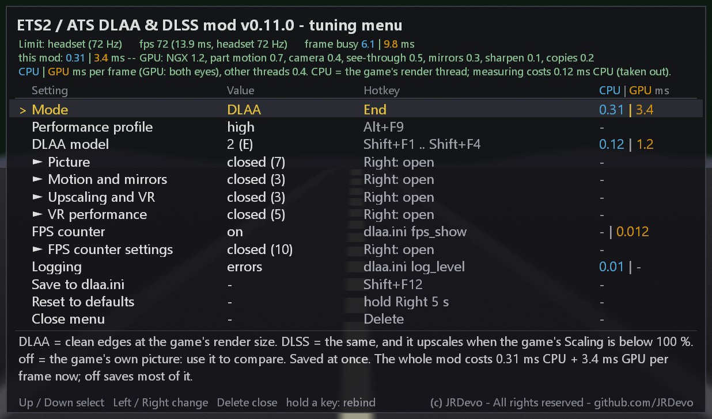
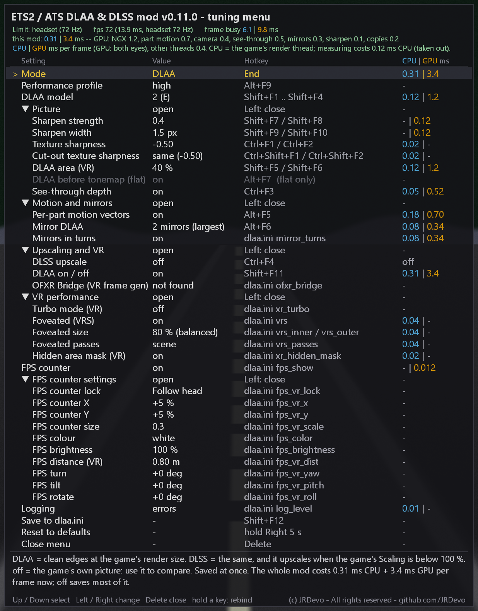
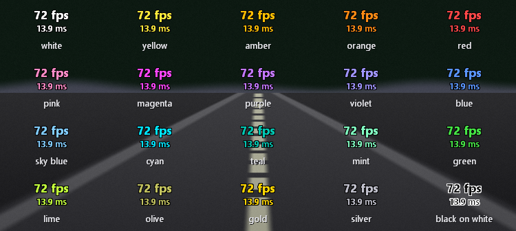
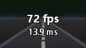

> [!CAUTION]
> ## THIS GITHUB PAGE IS THE ONLY PLACE THIS MOD EXISTS
> **`https://github.com/JRDevo/ETS2-ATS-DLAA-DLSS-Injection-Mod` is the only source of truth for this mod: the only place it is
> published, the only place it is documented, and the only place to download it (its [Releases](https://github.com/JRDevo/ETS2-ATS-DLAA-DLSS-Injection-Mod/releases) page).**
>
> - There is **no website** for this mod. There **never will be** one. No Discord, no Patreon, no Nexus, no Steam Workshop, no app store.
> - **DO NOT DOWNLOAD THIS MOD FROM ANYWHERE ELSE.** Any other site, mirror, "launcher", "installer", video link or forum attachment that
>   offers it is not mine and may carry anything. If it did not come from this GitHub page, do not run it.
> - Updates, release notes, the hotkey list and the troubleshooting guide live here and only here. If someone tells you to get the mod
>   somewhere else, they are wrong.

# ETS2 & ATS: DLAA & DLSS Injection Mod

An **ETS2 DLSS mod** and **ATS DLSS mod**: NVIDIA DLAA and DLSS for
**Euro Truck Simulator 2** and **American Truck Simulator**, on a flat screen and in VR, with Windows HDR.
It replaces the game's own anti-aliasing with DLAA (anti-aliasing at native resolution) and can
upscale with DLSS for more frame rate.

It is one small `dinput8.dll` in the game folder. No launcher, no account: a few hotkeys,
an in-game menu (`Delete`) and an optional text config.

**An NVIDIA RTX GPU is required** (DLAA and DLSS only run on RTX cards).

**Menu:** [Features](#features) · [Download](#-download) · [Requirements](#requirements) · [Install](#install) · [Modes](#modes--the-end-key) · [Flat or VR](#flat-or-vr) · [OFXR Bridge](#ofxr-bridge-vr-frame-generation) · [Render scale](#how-render-scale-works) · [Models](#models-presets--which-one-to-use) · [Controls](#controls) · [Tuning menu](#the-tuning-menu) · [dlaa.ini](#dlaaini) · [Performance](#performance) · [Troubleshooting](#troubleshooting) · [Multiplayer](#multiplayer) · [Build](#build-from-source) · [Report a problem](#reporting-a-problem-what-to-upload) · [Contributing](#contributing-logs-flicker-captures-code) · [License](#license-and-credits)

> **Where the project stands (v0.13.0).** The mod was built for as many use cases, devices and situations as
> I could reach: flat and VR, one screen and three, keyboard, wheel and shifter, Reflex and frame rate caps,
> foveated rendering, a hidden area mask, Turbo mode, CPU tuning, a tuning menu with every setting and its cost.
> There are many options to tweak, and to tweak is paradise. The bells and whistles I know of are in; the ideas
> left on my list are not worth their cost. From here on the main work is **performance tuning on your hardware**,
> and that needs your logs: see [Contributing](#contributing-logs-flicker-captures-code). If you have a suggestion,
> a feature idea or a device I have not thought of, [open an issue](../../issues/new/choose) (Feature request).

## Features

**Picture quality**
- **DLAA / DLSS** on the whole picture: no shimmer on fences, wires, road marks and shadows.
- **Mirrors anti-aliased too**, trailer included.
- **Exact motion for traffic**, wheels, trailers and plates: sharp, no ghosting.
- Menu and truck-preview screens get anti-aliasing as well.
- Four DLSS models, switched live with a key.
- Sharper texture text and adjustable sharpening.

**Flat and VR**
- One DLL and one `dlaa.ini` for both; VR renders one pass per eye (OpenXR).
- **Triple screens** in flat: every screen gets its own DLAA. **new**
- Windows HDR and NVIDIA Smooth Motion work in flat mode.
- OFXR Bridge (VR frame generation) works alongside.
- Drivable cars (ATS) get DLAA / DLSS too.

**VR extras and speed**
- **VR fps counter attached to the vehicle**: rides with the cab; 20 colours. **new**
- Three VR speed-ups: hidden area mask, foveated lighting, mirrors in turns. **new**
- DLAA area: process only the middle of each eye.
- **Frame rate limits**: NVIDIA Reflex and an FPS cap in flat, a half / third rate VR FPS cap. **new**

**Menu**
- **In-game menu** (`Delete`): every setting, its hotkey, its GPU cost, a short description.
- Panel and fps counter can be moved and resized, flat and VR.
- Live CPU and GPU cost per part, and what limits your frame rate.

**Setup**
- A single `dinput8.dll`; delete it to uninstall.
- Hotkeys with beeps, usable blind in a headset; every key can be re-bound.
- Drop in a newer `nvngx_dlss.dll` any time for NVIDIA's newer models.
- Debug log for bug reports (off by default).

<details><summary><b>More detail on each feature</b></summary>

- **DLAA** — NVIDIA anti-aliasing at the game's render resolution. It removes the shimmer and flicker on
  fences, power lines, road markings and shadows that the game's own AA leaves behind.
- **DLSS upscaling** — render fewer pixels and let DLSS rebuild the full picture, for more frame rate.
- **Flat and VR** — one DLL and one `dlaa.ini` for both. VR runs one pass per eye (OpenXR).
- **In-game tuning menu** — press `Delete` for a panel with every setting, its value, its hotkey, what it
  costs on the GPU and a short description; `Up` / `Down` select, `Left` / `Right` change. Flat and VR (both eyes); the game does
  not see those keys while the menu is open. See [The tuning menu](#the-tuning-menu).
- **Movable widgets** — the tuning panel and the live fps counter can both be moved and resized from the menu
  (position X / Y and size), flat and VR each with their own place. In VR the panel turns to face you.
- **Live CPU and GPU cost** — the menu shows what each part of this mod costs on the CPU and the GPU, in ms, and what
  limits your frame rate right now (CPU, GPU or the headset).
- **Triple screens (flat)** — with the game's multi-monitor mode every screen gets its own DLAA (new in v0.12.0).
- **VR speed-ups** — hidden area mask (the lens corners are not drawn), foveated rendering also on the lighting pass,
  mirrors in turns; all off by default, each a menu row (new in v0.12.0).
- **VR fps counter attached to the vehicle** — rides with the cab on bumps, braking and hills; 20 colours, brightness,
  distance and turn (new in v0.12.0). New in v0.13.0: the box sits on the cab itself and keeps its place after menus and recentring, every vehicle keeps its own box (place, size, colour, brightness, text, opacity), and the text has 7 choices.
- **Frame rate limits** — in flat, NVIDIA Reflex (less input lag when the GPU is the limit) and an FPS cap (a steady
  frame time, less heat). In VR, a cap at half or a third of the headset rate, so the headset's reprojection (ASW /
  Motion Smoothing) fills the frames in between at a steady rhythm. All off by default, each a menu row (new in v0.13.0).
- **Night light glow fix** — street lamp and car light glows no longer leave a trail behind them at night; a menu row
  (`Light glow ghosting fix`, `dlss_bias_mask`) sets the strength (new in v0.13.0).
- **Lit areas under canopies** — the game's lighting pass draws some meshes a second time (sunlight through a tent
  canopy); they now match the DLAA picture and no longer flicker on and off (`light_redraw_jitter`, new in v0.13.0).
- **CPU tuning** — optional: Intel P-cores for the game's main threads, Above normal priority, no power throttling;
  one menu row, off by default (new in v0.13.0).
- **Hotkeys page** — bind every menu hotkey in the menu itself with one press; only the five menu keys are kept from the
  game while the menu is open (new in v0.13.0).
- **Windows HDR** — works with HDR on in flat mode.
- **NVIDIA Smooth Motion** — works with the driver's frame generation switched on, in flat mode.
- **OFXR Bridge (VR frame generation)** — runs together with the bridge, which adds in-between frames to the
  finished eye pictures (see [OFXR Bridge](#ofxr-bridge-vr-frame-generation)).
- **Drivable cars (ATS)** — DLAA / DLSS also runs while you drive a car.
- **Menu and truck-preview screens** get anti-aliasing too, not only the drive.
- **Four DLSS models** to pick from, switched live with a key, from light to heavy.
- **Exact motion for moving traffic** — every part of the 3-D world is matched with the
  previous frame, so traffic, wheels, trailers and licence plates get their own motion vectors and stay
  sharp under DLAA / DLSS instead of ghosting; everything static keeps the camera motion, which is taken from
  the scenery as a whole (a moving truck can no longer pass for the camera). See-through parts drawn after
  the scene (plates, decals, glass, wires) get their own motion too, and parts the game rebuilds every frame
  (licence plates) take the motion of the vehicle they sit on. On by default (`mv_objects = 2`).
- **Mirrors anti-aliased too** — every truck / car mirror gets its own DLAA with its own
  jitter and motion vectors (your trailer in the mirror stays sharp), on by default (`mirror_dlaa = 1`,
  `Alt+F6` switches it live).
- **DLAA on the game's HDR colours** — in flat DLAA mode the main picture is anti-aliased
  before the game's own tone-mapping, the input NGX is made for, so thin bright lines shimmer less. On by
  default (`dlaa_pre_tonemap = 1`, `Alt+F7` switches it live); DLSS upscaling, VR and Windows HDR keep the
  end-of-frame path.
- **Sharper texture text** — texture LOD bias: road signs, dashboard, GPS and truck decals
  get sharper textures while DLAA / DLSS keeps them from shimmering. Off by default, adjust live with
  `Ctrl+F1` / `Ctrl+F2`.
- **Adjustable sharpening** — strength and width, live.
- **DLAA area (VR)** — process only the middle of each eye to save GPU time.
- **Hotkeys with beeps** — made to use blind in a headset; every key can be re-bound in `dlaa.ini`.
- **Bring your own `nvngx_dlss.dll`** — drop in a newer one at any time to get NVIDIA's newer models.
- **Small and simple** — a single `dinput8.dll`. No launcher, no account. Delete the file
  to uninstall.
- **Debug log** for bug reports (off by default).

</details>

| Tuning menu, groups closed | Tuning menu, groups open | FPS counter colours |
|---|---|---|
|  |  |  |

## ⬇ Download

**[Download the latest release here](https://github.com/JRDevo/ETS2-ATS-DLAA-DLSS-Injection-Mod/releases/latest)**
— get the `.zip` under **Assets**, then follow [Install](#install) below.
(The green **Code** button downloads the source code, not the mod.)

This is an unofficial fan project. It is not affiliated with, or endorsed by, SCS
Software or NVIDIA. Euro Truck Simulator 2 and American Truck Simulator are
trademarks of SCS Software; DLSS and DLAA are trademarks of NVIDIA Corporation.

> Status: v0.13.0. New: NVIDIA Reflex and frame rate caps, a Hotkeys page in the menu, a per-vehicle fps box in VR, a night light glow fix, CPU tuning, and fixes for Linux / Proton.
> With this version the bells and whistles I know of are in. From here on the main work is performance tuning, from your logs; new ideas are still welcome. See [Contributing](#contributing-logs-flicker-captures-code).
> See the [Releases page](https://github.com/JRDevo/ETS2-ATS-DLAA-DLSS-Injection-Mod/releases) for every version.
> DLSS upscaling in VR is still being tuned; treat it as experimental.

<details><summary>Older versions</summary>

v0.12.0: triple screens in flat, the VR fps counter attached to the vehicle, a menu in categories with a CPU | GPU cost column, hidden area mask, foveated lighting pass and mirrors in turns.

v0.11.0: Turbo mode (VR), foveated rendering (VRS), logging levels in the menu, about half the GPU cost for the per-part motion vectors in busy cities, fixes for issue #8 (OptiScaler: mirror DLAA starts off) and issue #9 (DLSS stopped on the eyes after a VR minimize / restore). v0.10.3: in VR the tuning menu and the fps box are OpenXR quad layers placed by the headset (`menu_vr_layer`): steady, never covered by the game's menus, at a real distance (`menu_vr_dist`), with the fps box optionally fixed in the cab (`fps_vr_lock`). Hold a key or wheel button on a menu row to bind it; Reset to defaults is a 5 s hold; Panel / FPS settings are collapsible groups. v0.10.2 (unpublished): VR performance pass (`mv_cons_fail_tol`, mirror units pre-built on the loading screen, `mv_area_clip`, camera-only mirrors `mirror_mv`), the 7-choice Mirror DLAA row, wheel / D-pad bindings. The DLSS
*upscaling* path (render below native, reconstruct up) runs in VR but is still
being tuned. Treat upscaling as experimental. The OFXR Bridge handling is not yet tested in a headset with the bridge armed.

</details>

---

## Requirements

- Euro Truck Simulator 2 or American Truck Simulator (64-bit, DirectX 11).
- An **NVIDIA RTX** GPU with a current driver.
- `nvngx_dlss.dll` — the NVIDIA DLSS runtime. **This mod does not ship it**; see
  Install below.
- For VR: an OpenXR runtime (for example Virtual Desktop), launched with the game's `-openxr`
  option.

## Install

<details>
<summary><b>Show</b></summary>

1. **Make a backup** of the game's `bin\win_x64\` folder first.
2. [Download the latest release zip](https://github.com/JRDevo/ETS2-ATS-DLAA-DLSS-Injection-Mod/releases/latest)
   and unzip it.
3. Find the game's executable folder, e.g.
   `...\steamapps\common\Euro Truck Simulator 2\bin\win_x64\`
   (or `...\American Truck Simulator\bin\win_x64\`).
4. **Remove any other proxy mod first.** Only one `dinput8.dll` / `dxgi.dll` proxy
   can load — delete any other mod's `dinput8.dll` or `dxgi.dll` from that
   folder before continuing.
5. Copy **`dinput8.dll`** into `bin\win_x64\`. Optionally also copy **`dlaa.ini`**
   there to change settings or keys (see below) — it is not required.
6. **Add the NVIDIA DLSS runtime yourself.** This mod ships **no** NVIDIA files.
   Put your own **`nvngx_dlss.dll`** in the same `bin\win_x64\` folder, next to
   `dinput8.dll`. You can get it from:
   - the NVIDIA DLSS SDK on GitHub — <https://github.com/NVIDIA/DLSS>, file
     `lib/Windows_x86_64/rel/nvngx_dlss.dll`, **or**
   - any game that already ships `nvngx_dlss.dll` (copy that file).

   You can drop in a **newer** `nvngx_dlss.dll` at any time to update the DLSS model
   — just replace the file.
7. Launch the game. DLAA starts on. The log file only gets errors unless you set
   `log_level = 4` in `dlaa.ini` (see Troubleshooting).

To uninstall, delete `dinput8.dll` (and `dlaa.ini`) from `bin\win_x64\`.

</details>

## Linux / Proton

<details>
<summary><b>Show</b></summary>

Install the files the same way as on Windows (see Install above). Then tell Proton to load
the mod's `dinput8.dll` instead of its own. In Steam, open the game's **Properties** and set
the **Launch Options** to:

```
WINEDLLOVERRIDES="dinput8=n,b" %command%
```

From this version on, the C++ runtime and the shaders are built into `dinput8.dll`. You do
**not** need `vcrun2026` or `d3dcompiler_47` any more.

Older versions need both. If you use an older version, install them with protontricks
(227300 = ETS2, 270880 = ATS):

```
protontricks 227300 vcrun2026
protontricks 227300 d3dcompiler_47
```

**AMD cards** work through [OptiScaler](https://github.com/optiscaler/OptiScaler). Rename
OptiScaler's DLL to `winmm.dll` and add `winmm=n,b` to the override:

```
WINEDLLOVERRIDES="dinput8=n,b;winmm=n,b" %command%
```

Thanks to **rimaille** for the Linux testing and these steps
([discussion #13](https://github.com/JRDevo/ETS2-ATS-DLAA-DLSS-Injection-Mod/discussions/13)).

</details>

## Modes — the `End` key

<details>
<summary><b>Show</b></summary>

Press **`End`** in game (no modifier) to cycle the mode. The choice is saved to
`dlaa.ini` immediately and used again next launch.

| Mode | What it does | Beep |
|------|--------------|------|
| **DLAA** | NVIDIA AA at the game's render resolution; the game stretches the result to the output size | 1 high beep |
| **DLSS** | NVIDIA reconstructs from the render resolution **up** to the output size (upscaling) | 2 high beeps |
| **off** | the game's own picture, no injection | 1 low beep |

At 100 % render scale DLAA and DLSS produce the same picture; the difference only
shows once you render below native (see render scale below).

</details>

## Flat or VR

<details>
<summary><b>Show</b></summary>

The mod reads the game's launch options at start. With `-openxr` or `-oculus` it runs in VR mode
(one DLAA / DLSS pass per eye; the desktop mirror window is left alone). Without them it runs in flat mode.
The log says which: `launch mode: VR` or `launch mode: FLAT`. One `dlaa.ini` serves both.

If the launch options say VR but no headset session starts (the game then runs on the monitor), the mod
notices after about one second of driving and switches to flat mode by itself (`launch mode FALLBACK` in the log).

</details>

## OFXR Bridge (VR frame generation)

<details>
<summary><b>Show</b></summary>

[OFXR Bridge](https://github.com/djules75/OFXR-Bridge) is a separate program that adds in-between frames in VR: it takes the finished
picture of each eye and generates the frames between them from optical flow. The mod runs together with it. The mod
anti-aliases / upscales each eye as usual; the bridge then works on the finished eye pictures. It needs no motion vectors from
the mod. The mod only makes sure the bridge's own copies inside the game are left alone (they are not counted as game drawing).

- **Order:** install the mod as usual. Start `OFXRBridgeTray.exe` and arm it **before** you launch the game with `-openxr`.
  Nothing to change in `dlaa.ini`.
- **Never run the game as administrator.** The bridge installs a per-user layer, and Windows ignores per-user layers for a
  program that runs as administrator, so the bridge would silently do nothing.
- **Switch off:** `ofxr_bridge = 0` in `dlaa.ini` switches the mod's handling off (default 1). It does nothing when the bridge is not
  there.
- **In the log** (`log_level = 3` or `4`): `OFXR Bridge: layer module ... loaded` when the bridge's layer shows up in the game (it loads when the
  game starts its VR session, so it can appear a little after start), `OFXR Bridge: tray.ini found` / `not installed`, and
  `OFXR Bridge: N calls passed through so far`.

Status: the handling is built but not yet tested in a headset with the bridge armed; report what you see with `log_level = 4`.

</details>

## How render scale works

<details>
<summary><b>Show</b></summary>

The game renders the 3-D scene at `r_scale_x` × `r_scale_y` of the output size and
then stretches it up. In **DLSS** mode this injector replaces that stretch with DLSS
reconstruction, so lowering the render scale buys performance with little quality
loss.

Set **both** `r_scale_x` and `r_scale_y` (game closed) in
`Documents\Euro Truck Simulator 2\config.cfg` (or `Documents\American Truck
Simulator\config.cfg`), e.g. `uset r_scale_x "0.667"` and `uset r_scale_y "0.667"`:

| DLSS mode | `r_scale_x` = `r_scale_y` | pixels rendered |
|-----------|---------------------------|-----------------|
| Quality | `0.667` | ~44 % |
| Balanced | `0.58` | ~34 % |
| Performance | `0.5` | ~25 % |

The injector picks the matching DLSS quality level automatically from the ratio.
In **DLAA** mode the render scale just sets the resolution DLAA runs at (no
upscaling).

**VR:** the per-eye output size is set by the game's VR supersampling cvar
`r_manual_stereo_buffer_scale` (and your headset/runtime resolution); `r_scale_x` /
`r_scale_y` then shrink the render below that eye size for DLSS to reconstruct back
up to it.

</details>

## Models (presets) — which one to use

<details>
<summary><b>Show</b></summary>

A "model" (NVIDIA calls it a *render preset*) is the neural network that cleans
the picture. All four remove jagged edges. They differ in detail, in how they
treat thin and moving things, and in GPU time. Switch live with `Shift+F1`..`F4`
(1 to 4 beeps) or in the tuning menu (`Delete`), look for a few seconds, then save
with `Shift+F12`.

| Key | Model | What it does | When to use it | GPU per eye, VR 3064x3248 |
|-----|-------|--------------|----------------|---------------------------|
| `Shift+F1` | **1** (preset `K`) | Most detail, sharpest text and far objects | Flat screen. VR only with frame rate to spare | 1.0 ms (measured) |
| `Shift+F2` | **2** (preset `E`) | Balanced: clean edges, least ghosting behind moving traffic | **Start here**, flat and VR | 0.6 ms (measured) |
| `Shift+F3` | **3** (preset `F`) | Softest and most stable on thin lines (fences, wires, blinds); can smear moving detail | When model 2 still shimmers on fences | 0.6 ms (measured) |
| `Shift+F4` | **4** (preset `M`) | NVIDIA's heaviest network, small gain over 1 | Flat screen tests only | about 3 ms (estimate from 9.4 ms at 4592x6496) |

The costs scale with the pixels the model works on: half the pixels, about half
the time. In VR the DLAA area (`Shift+F5` / `F6`) is the cheap way to afford a
heavier model: at area 40 % model 1 costs about what model 2 costs at 100 %.
The menu and truck-preview screens always use model 2, whatever you pick.

### Recommended settings

**Scaling** is the game's own slider: *Options → Graphics → Scaling*. **Stereo
buffer scale** is VR only and is not in the menu: with the game closed, set
`uset r_manual_stereo_buffer_scale "1.5"` (for example) in `config.cfg`.

| Your setup | Mode (`End`) | Model | Scaling (in game) | Stereo buffer scale |
|------------|--------------|-------|-------------------|---------------------|
| **Flat**, strong card | DLAA | 1 | 100 % | not used |
| **Flat**, need more frame rate | DLSS | 1 or 2 | 75 % (or 50 %) | not used |
| **VR**, top-end card | DLAA | 2 (1 if the frame rate holds) | 100 % | 1.0 to 1.25 |
| **VR**, mid-range card | DLSS | 2 | 75 % | 1.0 |

- **Flat:** do not set Scaling above 100 %. The mod already removes the jagged
  edges, so extra pixels only cost frame rate.
- **VR:** `1.0` is what the headset can show (Quest 3 through Virtual Desktop at
  its top setting gets about 3072 x 3216 per eye, and `1.0` in ATS / ETS2 is
  3064 x 3248). `1.25` is a little sharper for about 55 % more GPU. `2.0` draws
  four times the pixels and the headset never shows them: with DLAA on, that is
  wasted. Keep Scaling at 100 % in DLAA mode; use Scaling below 100 % only with
  **DLSS** mode, to win frame rate back.
- **Scaling below 100 % only makes sense in DLSS mode.** In DLAA mode the game
  just stretches the smaller picture and it looks soft.
- The slider has fixed steps. Values in between (for example `0.667`) can be set
  in `config.cfg`, see *How render scale works* above.
- These are starting points. Measured on an RTX 5090 with a Quest 3: model 2 at
  stereo buffer scale 1.0 and Scaling 100 % holds 72 fps with the GPU about 60 %
  busy; at 1.25 about 85 %. Watch your own frame rate and move one step up or down.

How to pick a model:

1. Start with **model 2**. Drive for a minute. Watch thin things in the distance:
   power lines, fences, lamp posts, road markings.
2. Frame rate is still fine and you want more detail? Try **model 1**. If the
   frame rate drops (in VR: stutter or reprojection), go back to 2 — or, in VR,
   make the DLAA area smaller with `Shift+F5` so model 1 only works on the middle
   of the view.
3. Still shimmer on model 2? Try **model 3**. If the road or fences look smeared
   while moving, go back to 2.
4. Press `Shift+F12` to save.

What to expect:

- **No model makes the picture sharper than what the game renders.** They remove
  crawling and flicker on edges. If the picture is soft, raise the render scale
  (see above) or the sharpening (`Shift+F7` / `F8`); do not look for a "sharper
  model".
- **Cost grows with resolution.** As an example, on a top-end card at a very high
  VR resolution (about 4600 × 6500 per eye) we measured per eye: model 2 and 3
  about 1 ms, model 1 about 2.5 ms, model 4 about 9 ms. At 72 Hz a frame has
  14 ms in total, for both eyes and the game. On a flat 1440p or 4K screen all
  of them are much cheaper.
- **Things that move on their own** (traffic, wheels, wipers) can show a little
  ghosting with any model. The mod knows how the camera moves, not how each
  object moves.
- **A model change takes one short hitch** (a few hundredths of a second) while
  the new network loads.
- **The menu and truck-preview screens always use model 2.** The model keys only
  change the picture while driving.
- Which models exist depends on the `nvngx_dlss.dll` you installed. `E` and `F`
  are older models that newer DLSS files may drop one day; if a model cannot be
  created the mod falls back to model 1 by itself. More letters (`J`, `L`) can be
  set with `dlss_preset` in `dlaa.ini`.
- The same model is used in **DLAA** and **DLSS** mode. The mode (`End` key)
  decides *what resolution* the model works from; the model decides *how* it
  cleans the picture.

</details>

## Controls

<details>
<summary><b>Show</b></summary>

**You only need three keys** — or the `Delete` menu, which has every setting on one panel. Everything else is tuning,
and the defaults are tuned already.

### Daily keys

| Key | What it does |
|-----|--------------|
| `End` | Mode: DLAA → DLSS → off (saved at once) |
| `Alt+F9` | Performance profile: high → medium → low. high = everything on; medium = for mid-range GPUs (model E, cheaper mirror / see-through / plate work); low = for weak GPUs (also no mirror DLAA, no see-through depth, VR DLAA area 60 %) |
| `Shift+F12` | Save the current live settings to `dlaa.ini` |
| `Delete` | Tuning menu: every setting with its hotkey; arrow keys select and change, see [The tuning menu](#the-tuning-menu) |

Everything else is tuning. The defaults are tuned already; you can ignore the rest.

**Every key can be changed.** Open `dlaa.ini`, find the `key_<action>` line for the
action and edit the key, e.g. `key_dlaa_toggle = Ctrl+D` (or `none` to turn it
off). Restart the game. Full list: [`docs/KEYS.md`](docs/KEYS.md). A wheel / gamepad button or D-pad can be added after a
comma (`key_menu = Delete, Wheel10`), so the tuning menu can be driven from the wheel.

By default every control except `End` and the menu keys (`Delete`, arrows) is an **F-key with one modifier**, so it can be used
blind in a headset. The game window must be focused. Each key beeps to confirm (pitch tracks
the value); a long low tone means "already at the limit" or "save failed". Turn beeps off with
`beeps = 0` in `dlaa.ini`.

### Tuning keys

<details>
<summary>Show the tuning keys</summary>

| Default key | What it changes, and when you would touch it |
|-----|--------|
| `Shift+F1`..`F4` | DLAA model / preset: 1 = default (driver pick), 2 = `E`, 3 = `F`, 4 = `M`. Touch it if the picture shows ghosting or smearing and you want to try another model |
| `Shift+F5` / `F6` | DLAA area − / + 10 %, `10`..`100` % (shrinks the processed region; VR only, flat always uses the whole picture). Touch it in VR to trade picture quality for GPU time |
| `Shift+F7` / `F8` | Sharpening strength − / + 0.1. Touch it if the picture looks too soft or too crunchy |
| `Shift+F9` / `F10` | Sharpening width − / + 0.5. Touch it together with strength, only if you changed the sharpening |
| `Shift+F11` | DLAA on / off. Touch it to compare with and without |
| `Ctrl+F1` / `F2` | Texture sharpness: LOD bias − / + 0.25 on the solid surfaces (road signs, dashboard, GPS), `−3`..`0`; only while DLAA / DLSS is on. Touch it if sign and dashboard text looks soft; try −0.5 to −1 |
| `Ctrl+Shift+F1` / `F2` | Cut-out sharpness: LOD bias − / + 0.25 of the see-through draws (wire-mesh fences, grass, leaf cut-outs), `−3`..`0`. Touch it if fences moire or grass looks soft |
| `Alt+F5` | Per-part motion vectors on / off. Touch it only to compare traffic ghosting with and without |
| `Alt+F6` | Mirror DLAA on / off. Touch it if the mirrors look wrong or cost too much GPU time |
| `Alt+F7` | DLAA before / after the game's tone-mapping (flat mode). Touch it only to compare thin bright lines (lane paint, wires, rails) |
| `Ctrl+F3` | Wire depth (forward depth for the motion vectors) on / off. Touch it only to compare wires, fences and lane paint |
| `Ctrl+F4` | DLSS upscale on / off. Touch it to force DLAA-only while the render scale is below 100 % |

</details>

### Debug keys

<details>
<summary>Show the debug keys</summary>

These need `log_level = 4` in `dlaa.ini`. They are for diagnostics and bug reports; you can ignore them when playing.

| Default key | Action |
|-----|--------|
| `Ctrl+F5` | Motion vectors on / off |
| `Ctrl+F6` | Motion-vector debug view (needs DLAA or DLSS on) |
| `Ctrl+F7` | Passive mode on / off |
| `Ctrl+F8` | Jitter-only debug on / off |
| `Ctrl+F9` | Self-test (dumps frames) |
| `Ctrl+F10` | NGX input snapshot |
| `Ctrl+F11` | Frame trace |
| `Ctrl+F12` | Cycle NGX jitter sign |
| `Alt+F8` | Per-part motion dump of the next frame into the log |

</details>

The full sheet with every beep pattern is in [`docs/KEYS.md`](docs/KEYS.md).

</details>

## The tuning menu

<details>
<summary><b>Show</b></summary>


Press **`Delete`** in game and a panel with every setting opens over the picture: name, current
value, the hotkey for it, the CPU and GPU cost, and for the selected row a description: what it does, when you would change
it, what it costs or saves. **`Up` / `Down`** select a row,
**`Left` / `Right`** change it, `Delete` closes it again (two short beeps on open, one low beep on close).

**The columns:**

| Column | What it shows |
|--------|---------------|
| **Setting** | The name of the setting. A greyed row does not apply right now (for example VR-only rows in flat mode). |
| **Value** | The current value. `Left` / `Right` change it. |
| **Hotkey** | The key that does the same thing without the menu, or the `dlaa.ini` key for rows that have no hotkey. |
| **CPU \| GPU ms** | What this row costs right now, in ms per frame: the CPU figure in **blue**, the GPU figure in **orange**, e.g. `0.12 \| 0.62` (`-` = that side does not apply or is not measured, `...` = still measuring, `off` = switched off, `same` / `no extra` = no extra cost). |

**Categories (phase 43):** the menu is in groups you open and close. `Mode`, `Performance profile` and `DLAA model` are
always shown. Then come the groups: `Picture` (sharpening, texture sharpness, DLAA area, tonemap, see-through depth),
`Motion and mirrors`, `Upscaling and VR` (DLSS upscale, DLAA on / off, OFXR Bridge), `VR performance` (Turbo, foveated
rendering, hidden area mask), `Frame rate and CPU` (Reflex, FPS cap, VR FPS cap, CPU tuning), `Panel settings` and `FPS counter settings`.
After them: `FPS counter`, `Logging`,
`Save`, `Reset` and `Close`. Select a group and press `Right` to open it, `Left` to close it. A closed group shows `►` and
`closed (N)` (N = its rows); an open group shows `▼` and `open`, with its rows indented below it. All groups are closed again each time you open the menu.


(These pictures are rendered by the real menu code, see `tests/menu_shot.cpp`; the figures in them are examples.)

The three green lines under the title show the game's GPU time per frame, what this mod costs, and the fps. The line at the bottom explains the selected row.

- **Flat:** the panel sits near the top-left corner of the screen.
- **VR:** the panel shows in both eyes, centred in front of you, and on the desktop mirror window -- also on the
  VR main menu and the garage / truck dealer screens, before a save is loaded.
- **You can keep driving with the menu open (v0.13.0):** only the five menu keys / buttons (by default `Delete` and the
  arrow keys) are kept from the game while the menu is open; every other key, wheel and gamepad button, your shifter, the
  steering and the pedals reach the game as usual. (v0.10.2 to v0.12.0 kept every key and button from the game.) Closed,
  the menu keys belong to the game again.
- **Hotkeys page (v0.13.0):** select **`Hotkeys...`** (near the bottom, above `Save`) and press `Right`: the panel shows
  one line per hotkey action (`Sharpen strength -` and `Sharpen strength +` are separate lines, so are the four models and
  the five menu keys) with its keyboard key and its wheel / gamepad button. `Up` / `Down` select a line, `Left` (or
  `Right` on `< Back`) goes back to the main menu.
- **Bind a key:** select a line and press `Right`. The line reads `Press a key or button...`: press the new key (hold
  `Ctrl` / `Shift` / `Alt` with it for a combination) or the new wheel / gamepad button or D-pad direction. Two rising
  beeps, and it is that action's hotkey from now on, written to `dlaa.ini` at once. A key replaces the keyboard key and
  keeps the wheel button, a wheel button the other way round. A key or button that already belongs to another hotkey is
  taken away from it (the line says `taken from key_...` for 3 s). `Left` or `Esc` cancels, **`Backspace` clears** the
  hotkey (`none`), and so does nothing for 10 s (cancel). Only a **new press** counts: a key or button that is already
  held when you press `Right` -- an H-shifter in gear, a held pedal button -- is ignored until you let it go and press it
  again (issue #16), and steering / pedal axes never bind. While the line waits (a few seconds at most) the game gets no
  keys or buttons, so the press you bind with does nothing in the game.
- **Menu keys:** the last five lines (`Menu: open / close`, `up`, `down`, `left`, `right`) are the keys that drive the
  menu. There every key counts, the menu keys too (so `Left` binds instead of cancelling): `Esc` or `Backspace` cancels,
  or wait 10 s. They cannot be cleared, and each of the five must keep a binding: a press that would take the only
  key of another menu action (give `Menu: left` the Right arrow) is refused. Swap two keys by giving one of them a third
  key first. The **Menu keys** row in the `Panel
  settings` group shows them; `Right` on it opens the Hotkeys page there. See
  [`docs/KEYS.md`](docs/KEYS.md#bind-a-key-in-the-menu).
- **Groups (v0.10.3):** the panel rows (`Panel position X` / `Y`, `Panel size`, `Panel VR depth`, `Panel faces you`,
  `Menu keys`) sit in the **Panel settings** group and the fps box rows (`FPS counter lock`, `X`, `Y`, `turn`, `tilt`, `rotate`, `size`, `colour`,
  `brightness`, `distance`) in the
  **FPS counter settings** group, right under the `FPS counter` row. Both groups are closed every time the menu
  opens: select the group row and press `Right` to show its rows, `Left` to hide them again.
- Every row calls the same function as its hotkey: the hotkeys keep working while the menu is open, and every change
  beeps and logs exactly like its key. Number rows repeat while you hold `Left` / `Right`.
- **Move the widgets:** the panel and the fps counter both move. For the panel open `Panel settings` and use the `Panel position X`, `Panel position Y` and `Panel size` rows (and `Panel VR depth` in VR,
  which brings the panel nearer). Flat and VR keep their own position (`menu_x`, `menu_y`, `menu_scale`,
  `menu_vr_x`, `menu_vr_y`, `menu_vr_scale`, `menu_vr_dist` / `menu_vr_depth`, `menu_vr_face` in `dlaa.ini`).
- **VR: the panel faces you.** Move it to the side or up / down and it turns towards your eye like a real screen,
  keeping its size from every angle (`Panel faces you (VR)` row, `menu_vr_face`, on by default; off = a flat picture).
  On the garage / truck dealer screens the panel and the fps box are drawn on top of the game's own menu, not under it
  (the mod finds where the game hands each eye picture to the headset in the first frames after the menu opens).
- **VR: rock-steady panel (v0.10.3).** By default (`menu_vr_layer = 1`) the panel and the fps box are separate OpenXR
  layers: the headset's compositor shows them itself, on top of the game picture, so they do not swim or jitter with
  the reprojection, sit at a real distance (the panel 1 m away by default, the fps box 0.8 m) and are never covered by
  the game's menus. `Panel VR depth` then sets the panel's distance in metres (`menu_vr_dist`, 0.30 - 3.00 m, 5 cm
  steps; it keeps its size, only the depth changes) and `Panel faces you` turns the panel -- and the fps box when it
  follows your head -- towards you as a true 3-D layer. With `menu_vr_layer = 0` (the panel drawn into the picture, as
  before; also the automatic fallback when the layers are not possible) `Panel VR depth` is the inward shift in px
  (`menu_vr_depth`).
- **Live fps counter:**  the `FPS counter` row (Right / Left step `Off`, `72 fps + 13.9 ms`, `72 fps`, `13.9 ms`, and the same as plain numbers: `72 + 13.9`, `72`, `13.9`) switches on a small fps box: the fps and the frame time as text with a dark outline, no background (`60 fps` /
  `16.7 ms`, updated twice a second) that stays on screen also when the menu is closed (flat, and in VR in both eyes).
  Its own GPU cost is measured and shown in the row's cost column, per frame (all the pictures it is drawn into together).
  `FPS counter X`, `FPS counter Y` and `FPS counter size` (in the `FPS counter settings` group) move it; flat and VR keep their own position (`fps_show`,
  `fps_x`, `fps_y`, `fps_scale`, `fps_vr_x`, `fps_vr_y`, `fps_vr_scale` in `dlaa.ini`). Off, it costs nothing.
  The size goes from `0.2` to `3.0`; in VR it starts at `0.3` (small but readable in the headset).
  - **FPS colour:** 20 colours (white, yellow, amber, orange, red, pink, magenta, purple, violet, blue, sky blue, cyan,
    teal, mint, green, lime, olive, gold, silver, black on white). Each has an outline, so it reads on any picture
    (`fps_color`, 0 = white).

    
  - **FPS brightness:** 10 - 100 % in 10 % steps (`fps_brightness`, default 100). Dims the colour toward black (the
    outline stays; `black on white` dims its white outline instead). Flat and VR, live.
  - **FPS opacity:** 10 - 100 % in 10 % steps (`fps_opacity`, default 100). Fades the whole box, text and outline together. Flat and VR, live.
  - **FPS distance (VR):** how far away the box floats, 0.30 - 3.00 m (`fps_vr_dist` in cm, default 80). It keeps the
    same size in your view at every distance; only the depth changes.
  - **FPS turn / tilt / rotate (VR):** turn the box itself, in 1 degree steps (hold the key to go faster): turn = left / right, tilt = lean it back
    like a sticker on the dashboard, rotate = in its own plane (`fps_vr_yaw`, `fps_vr_pitch`, `fps_vr_roll`; 0 = it
    faces you, as before).
  - **FPS counter lock (VR):** where the box stays (`fps_vr_lock`). Right / Left step through the three choices:
    - `Follow head`: the box moves with your headset, always in the same spot of your view.
    - `Fixed in play space`: the box stays at one spot around your seat. It does not move when the cab sways on bumps,
      hills or when you brake, so the cab moves under it.
    - `Attached to vehicle`: the box sits on the cab like a sticker and sways with it, in trucks and in cars. It is
      placed where it was when you picked this choice (`X` / `Y` / distance / turn still move it, inside the cab).
      With all turns at 0 it is square to the cab (upright with the cab, facing your seat along the cab's own axes),
      wherever you recentred the headset, so the same `X` / `Y` mean the same spot in every truck.
      It needs DLAA on with `Per-part motion vectors` on (the defaults). Without them, in the outside camera, in menus
      and while loading it is exactly the `Fixed in play space` box (also as a quad layer) until you are steadily back
      in the cab. It only takes its spot when both eyes see the cab and the headset position is known. After a truck
      change it finds the new cab by itself after about a second.
      Every vehicle keeps its own placement, colour, brightness and text: when you get into a truck or car again (also
      after a game restart) the box goes back to exactly the spot in the cab where you put it in that vehicle; a new
      vehicle starts from the current values. Changes are saved automatically when the menu closes (`fps_profile` lines
      in `dlaa.ini`, one per vehicle; delete a line to forget that vehicle; the Reset row does not change them: the
      vehicle's own values come back when you attach the box again). A spot saved by an older version is squared to the
      cab once at the next lock-on, so the box may sit a little differently that one time.
  - **Re-measure cab spot (VR, attached only):** press Right while parked if the box sits off: the mod measures the cab
    again and keeps your position, turn, size and colour. Press Left to put just this vehicle's box back to the
    defaults (spot, turn, size, colour, brightness, text); other vehicles keep theirs.
  - **Position per vehicle (VR, attached only):** `On` (default) = the per-vehicle settings above; `Off` = one shared
    placement, colour, brightness and text for every vehicle (`fps_profiles` in `dlaa.ini`; the vehicle lines are kept).

    Which to pick: `Attached to vehicle` if you want it to look like part of the dashboard; `Fixed in play space` if
    you want it calm while the cab shakes; `Follow head` if you always want to see it.
- **Mirror DLAA** picks how many mirrors get DLAA and how they move: `off`, `1 mirror (largest)` (only the main mirror
  next to you), `1 mirror, camera`, `2 mirrors (largest)`, `2 mirrors, camera`, `all mirrors`, `all, camera motion`.
  Without `camera` each moving part moves exactly in the glass (about 0.4 ms per mirror in VR); with `camera` the mirror
  uses the camera motion only: the cheapest per mirror (about 0.15 ms), but moving traffic can ghost in the glass
  (`mirror_mv` in `dlaa.ini`). `Alt+F6` still switches it on / off.
- **Mirrors in turns** (`mirror_turns`, off by default): each mirror gets its DLAA only every 2nd frame and shows its
  last clean picture in between. That is about half the mirror cost. Edges in the glass stay clean; moving things in the
  glass update at half the frame rate (a slight judder on passing traffic). A reset or a big camera jump updates every
  mirror at once.
- **Turbo mode (VR)** (`xr_turbo`, off by default; from OpenXR Toolkit): the game stops waiting for the headset each
  frame. More fps only when the CPU is the limit. Warning: frame smoothing (ASW, Motion Smoothing, Motion Reprojection,
  SSW) does not work while it is on. Switch it off again if the picture judders.
- **Foveated (VRS)** (`vrs`, off by default; VR only, NVIDIA RTX only; from OpenXR Toolkit): sharp centre, lower detail
  at the edge. The outer ring of each eye picture is shaded once per 2 x 2 pixels, which saves GPU time at a high in-game
  Scaling. Fences, grass and leaves keep full detail, and so does everything the mod draws itself. **Foveated size** sets
  how big the sharp centre is, from 100 % down to 10 % in 5 % steps (`Right` = bigger). 80 % is the default (`balanced`);
  90 % = `wide`, 65 % = `narrow` (`vrs_outer` = the size, `vrs_inner` = 25 less, at least 10). On another GPU the
  row says `not supported`. Look for blocky edges at the side of your view; switch it off if they bother you.
  **Foveated passes** (`vrs_passes`) picks what it acts on: `scene` (default) = the 3D world only; `scene + lighting`
  = also the game's lighting pass, at the very edge only, for more saving. Test it before you keep it: look for blocky
  light or shadow edges at the side of your view.
- **Hidden area mask (VR)** (`xr_hidden_mask`, off by default; VR only): the game stops drawing the corners of each eye
  picture that the headset lenses never show (the VR runtime reports them). Fewer pixels drawn = more GPU headroom; what
  you see stays the same. The first time you switch it on, save (`Shift+F12`) and restart the game; after that the row
  switches it live. If your VR runtime has no such mask the row says `not supported`.
- **Frame rate and CPU** group (all off by default, all live):
  - **Reflex (flat)** (`reflex`): `off`, `on`, `on + boost`. NVIDIA only. The game's frames wait less in the GPU queue,
    so the input lag drops when the GPU is the limit. `on + boost` also keeps the GPU clocks up. On another GPU, or a
    driver that refuses it, the row says `not supported`. Not used in VR.
  - **FPS cap (flat)** (`fps_cap`): `off` or 30 - 360 fps (`dlaa.ini` takes any value from 20 to 1000). The game never
    runs faster than this. A cap a bit below what your PC holds in a busy city gives a steady frame time, less heat and
    less power. With Reflex on, the NVIDIA driver does the limiting; otherwise the mod waits after each frame (a precise
    timer, no drift).
  - **VR FPS cap** (`vr_fps_cap`): `off`, `half` or `third` of the headset rate (72 Hz: 36 or 24 fps; 90 Hz: 45 or 30).
    The game draws every 2nd (or 3rd) headset frame and the headset's reprojection (ASW, Motion Smoothing, Motion
    Reprojection, SSW) fills the frames in between at a steady rhythm. Use it when your fps swings around the headset
    rate: a steady half rate judders less than a rate that jumps. Make sure the headset's reprojection is on. Turbo mode
    is off while the cap is on (the cap wins; the Turbo row then says `on (FPS cap wins)`).
  - **CPU tuning** (`cpu_pcore`, `cpu_priority`, `cpu_no_throttle`): `off` or `on` (all three together); `mixed (dlaa.ini)`
    when they differ in `dlaa.ini`. Flat and VR. The game runs at Above normal priority, Windows may not slow it down to
    save power, and on Intel CPUs with P-cores and E-cores the game's main and render thread prefer the P-cores.
- **Logging** (`log_level`, `errors` by default): how much goes into `dlaa_inject.log` -- `off`, `errors`, `warnings`,
  `info` or `debug`, live. Its cost column shows what the logging costs on the CPU per frame (the description adds the
  lines per second; at `debug` also what the CPU profiler costs). `debug` also runs the mod's GPU timers and CPU
  profiler all the time; use it for bug reports, `errors` for play.
- **Hotkeys...** (v0.13.0) opens the Hotkeys page: every hotkey of the menu with its key and wheel button; bind one by
  pressing `Right` on its line and then the new key or button (see above).
- **Save to dlaa.ini** (the same as `Shift+F12`) writes the live values, and the panel position / fps box once you
  changed them.
- **Reset to defaults** puts every row back to the fresh-install values, live and in `dlaa.ini` (the keys are removed
  from the file; your hotkeys and every other line stay). Use it when you have changed too much. It is a **hold**: keep
  `Right` held on the row for 5 s (`bind_hold_ms`; the Hotkey column reads `hold Right 5 s` and fills a progress bar);
  let go earlier and nothing happens, `Left` does nothing there.
- **Where your time goes:** three lines under the title.
  - Line 1: **`Limit:`** what holds your frame rate back right now -- `headset` (VR: the game already runs at the
    headset's rate), `GPU`, `CPU`, `CPU and GPU`, `vsync / fps cap` (flat), or `unknown` when the numbers do not say it
    clearly (the mod never guesses). Then the fps, and how busy the frame is: CPU (blue) | GPU (orange) ms per frame.
    How it decides is in [Performance](#performance).
  - Line 2: what this mod costs in total, CPU | GPU ms per frame, and the GPU part split into DLAA/DLSS itself (NGX),
    per-part motion, camera motion, see-through depth, mirrors, sharpen and copies.
  - Line 3: the colour key (**CPU blue, GPU orange** -- not red and green, so colour-blind players can tell them apart),
    what the CPU figure covers (the game's render thread; the mod's work on other threads is listed apart) and what the
    measuring itself costs (already taken out of every figure).

  The cost column shows each row's share: `Mode` and `DLAA on / off` show the whole mod, `DLSS upscale` `no extra`, the
  texture sharpness rows CPU only (no GPU pass of their own), the Foveated and Hidden area mask rows CPU only (what they
  save shows up in the game's own GPU time, not in the mod's). All figures are milliseconds **per frame** (VR: the GPU
  figure covers both eyes), measured live and refreshed once a second; right after you open the menu they read `...` for
  about a second. **Measuring costs nothing while the menu is closed:** the mod's CPU profiler and GPU timers run only
  while it is open (or all the time at `log_level = 4`).
- Different keys: `key_menu`, `key_menu_up`, `key_menu_down`, `key_menu_left`, `key_menu_right` in `dlaa.ini`
  (see [`docs/KEYS.md`](docs/KEYS.md)).
- **From the wheel:** the menu (and every other hotkey) can also be driven from a wheel's D-pad and buttons, e.g.
  `key_menu = Delete, Wheel10` and `key_menu_up = Up, WheelUp`; see
  [`docs/KEYS.md`](docs/KEYS.md#wheel-gamepad-and-joystick-buttons) for how to find the button number.

</details>

## dlaa.ini

<details>
<summary><b>Show</b></summary>

Optional, placed next to `dinput8.dll`. One `key = value` per line; `#` or `;` start
a comment. It is read once at launch (the `config (...)` line in the log shows what
was used). The full template with every key and its default is in
[`docs/dlaa.ini.sample`](docs/dlaa.ini.sample). The keys most users care about:

**The five settings that matter:** `mode`, `perf_profile`, `dlss_preset`, `dlaa_area` (VR), `log_level`.
Everything else has a tuned default; see [`docs/dlaa.ini.sample`](docs/dlaa.ini.sample) for the full list.

The table below lists the commonly used keys:

| key | default | meaning |
|-----|---------|---------|
| `mode` | *(set by `End`)* | start mode: `1` DLAA, `2` DLSS, `0` off |
| `dlss_upscale` | `1` | `1` = allow DLSS upscaling when the render scale is below 1; `0` = DLAA only |
| `dlss_preset` | `default` | DLSS model: `default`, `J`, `K`, `L`, `M`, `E`, `F` |
| `sharpness` | `0.4` | sharpening after DLAA, `0`..`1` (`0` = off) |
| `sharp_radius` | `1.5` | sharpening width in texels, `1`..`4` |
| `dlaa_area` | `100` | run DLAA on the centre `N` % of each eye image (VR performance), `10`..`100`. VR only: in flat mode the whole picture is always used. Also used for the truck on the VR main menu / garage screens |
| `mv_objects` | `2` | motion vectors for moving traffic: `2` = every moving part gets its own exact motion (default), `0` = camera motion only (`1` = the older method, for comparison) |
| `mirror_dlaa` | `1` | DLAA on the truck / car mirrors: `1` = each mirror gets its own DLAA (default), `0` = mirrors are left as the game draws them. `Alt+F6` switches it live, `Shift+F12` saves. With OptiScaler next to the game exe (v0.11.0) it starts off by itself unless this key is set: its DLSS 5 bridge crashes on the mirror frames (issue #8). |
| `mirror_mv` | `parts` | motion in the mirrors (v0.10.2, VR and flat): `parts` = each moving part gets its own exact motion in the glass (default, about 0.4 ms per mirror in VR), `camera` = camera motion only (about 0.15 ms per mirror, moving traffic can ghost in the glass). Used with `mirror_vr_mode` / `mirror_flat_mode` 1, 2 and 3; mode 4 is always camera motion. The menu's Mirror DLAA row sets it live, `Shift+F12` saves |
| `mirror_turns` | `0` | mirrors in turns (VR and flat): `1` = each mirror gets its DLAA every 2nd frame and shows its last clean picture in between (about half the mirror cost; moving things in the glass update at half rate), `0` = every mirror every frame (default). The menu's `Mirrors in turns` row switches it live, `Shift+F12` saves |
| `dlaa_pre_tonemap` | `1` | DLAA before the game's tonemap (flat DLAA mode): `1` = on the game's HDR colours (default), `0` = on the finished picture at the end of the frame. `Alt+F7` switches it live, `Shift+F12` saves |
| `tex_lod_bias` | `0` | sharper texture text: texture mip LOD bias for the 3-D world while DLAA / DLSS runs, `-3`..`1`, `0` = off. Try `-0.5` to `-1`; more negative = sharper but more shimmer on fine patterns. `Ctrl+F1` / `F2` change it live, `Shift+F12` saves |
| `tex_lod_bias_auto` | `0` | `1` = while DLSS upscales, add log2(render width / output width) on top of `tex_lod_bias` (e.g. 75 % render width → −0.42) |
| `tex_aniso` | `0` | anisotropic filtering for the world textures: `0` = the game's own setting; `2`..`16` = at least this level (trilinear textures become anisotropic) |
| `preview_dlaa` | `1` | `1` = also anti-alias the profile / truck-preview screen (flat and VR); `0` = leave that screen untouched. VR at eye resolution needs a lot of GPU memory and time there, turn it off if that screen stutters. That screen always uses model 2 (preset E); the model keys change the drive only |
| `jitter_sign_x` / `jitter_sign_y` | `1` | flip if the image shimmers or looks doubled (try the 4 combinations) |
| `dlss_bias_mask` | `100` | light glow ghosting fix (phase 49): strength in % `0`..`100`, `0` = off. Street lamp and car light glows are told to DLSS as a mask so they leave no trail at night. Lower it (25 % steps) if glows flicker. The menu's `Light glow ghosting fix` row |
| `light_redraw_jitter` | `1` | phase 55: `1` = the lighting pass's mesh redraws (sunlight through canopies, emissive surfaces) use the same jittered viewport as the G-buffer; `0` = the game's viewport for the whole lighting pass (lit areas can flicker). Startup only |
| `dlss_hdr` | `1` | HDR only: `1` = tell DLSS the picture is HDR (normal); `0` = try this if HDR brightness or colours look wrong with DLAA on |
| `beeps` | `1` | `0` = silence the hotkey beeps |
| `menu_x` / `menu_y` / `menu_scale` | `2` / `8` / `1.0` | tuning menu panel, flat: left / top edge in % of the picture, size `0.3`..`2.0`. The menu's Panel rows change them live |
| `menu_vr_x` / `menu_vr_y` / `menu_vr_scale` / `menu_vr_depth` | `0` / `-5` / `1.0` / `12` | tuning menu panel, VR: centre offset from the eye's centre in % (`-50`..`50`, negative y = up), size (1 = 54 % of the eye width), inward shift per eye in px |
| `menu_vr_dist` | `100` | tuning menu panel, VR layer (v0.10.3, `menu_vr_layer = 1`): the panel's distance in cm (`30`..`300`); it keeps the same size at every distance, only the stereo depth changes. The menu's `Panel VR depth` row sets it in 5 cm steps on the layer path (`menu_vr_depth` is the in-picture shift) |
| `menu_vr_face` | `1` | tuning menu panel, VR: `1` = the panel turns to face your eye when moved off the centre (a tilted 3-D panel, same size from every angle), `0` = a flat picture. On the VR layer path (default) also the fps box when it follows your head, turned by the compositor. The menu's `Panel faces you (VR)` row switches it live |
| `menu_vr_layer` | `1` | VR (v0.10.3): `1` = the panel and the fps box are separate OpenXR quad layers the headset's compositor places itself: rock-steady (no swimming with the reprojection), at a real distance (panel `menu_vr_dist`, default 1 m; fps box 0.8 m), facing you with `menu_vr_face = 1`, never covered by the game's menus; `menu_vr_depth` is then unused. `0` = drawn into the eye picture as before (also the automatic fallback; `menu_vr_dist` unused) |
| `fps_show` | `0` | live fps box: `1` = a small fps / frame-time box stays on screen, also while the menu is closed. The menu's `FPS counter` row switches it live |
| `fps_text` | `0` | what the fps box shows: `0` = fps and frame time (two lines), `1` = fps only, `2` = frame time (ms) only, and the same as plain numbers without `fps` / `ms`: `3` = both, `4` = the fps number, `5` = the ms number. The menu's `FPS counter` row steps `Off` / `72 fps + 13.9 ms` / `72 fps` / `13.9 ms` / `72 + 13.9` / `72` / `13.9` |
| `fps_x` / `fps_y` / `fps_scale` | `1` / `1` / `1.0` | fps box, flat: left / top edge in % of the picture (`0`..`95`), size `0.2`..`3.0` (1 = 92 x 44 px at 1080 p) |
| `fps_vr_x` / `fps_vr_y` / `fps_vr_scale` | `0` / `-25` / `0.3` | fps box, VR: centre offset from the eye's centre in % (`-50`..`50`, negative y = up), size `0.2`..`3.0` (1 = 8 % of the eye width) |
| `fps_vr_lock` | `0` | fps box, VR (v0.10.3): `0` = follows the headset, `1` = fixed in the play space, `fps_vr_dist` from your seat; `fps_vr_x` / `fps_vr_y` are then degrees around you (+ = right / down). It does not follow the cab's sway. `2` = attached to the vehicle (phase 47): placed like `1` when picked, then it moves with the cab (needs DLAA + per-part motion vectors; otherwise it acts like `1`). The menu's `FPS counter lock` row switches it |
| `fps_color` | `0` | fps box colour (phase 44): `0`..`19` = white, yellow, amber, orange, red, pink, magenta, purple, violet, blue, sky blue, cyan, teal, mint, green, lime, olive, gold, silver, black on white. The menu's `FPS colour` row |
| `fps_brightness` | `100` | fps box brightness in % (phase 48): `10`..`100`, 100 = the colour as it is, lower dims it toward black. The menu's `FPS brightness` row |
| `fps_opacity` | `100` | fps box opacity in % (phase 51f): `10`..`100`, 100 = solid, lower fades the text AND its outline together (stored per vehicle in the `fps_profile` lines). The menu's `FPS opacity` row |
| `fps_vr_dist` | `80` | fps box, VR (phase 44): distance in cm (`30`..`300`), same angular size at every distance. The menu's `FPS distance (VR)` row |
| `fps_vr_yaw` / `fps_vr_pitch` / `fps_vr_roll` | `0` / `0` / `0` | fps box, VR (phase 44): the box's own turn in degrees: yaw `-90`..`90` (+ = its face turns right), pitch `-90`..`90` (+ = its top leans away), roll `-180`..`180` (+ = clockwise). The menu's `FPS turn` / `FPS tilt` / `FPS rotate` rows (1 degree steps) |
| `xr_turbo` | `0` | VR: `1` = **Turbo mode** (from OpenXR Toolkit): the game no longer waits for the headset each frame, so it can start the next frame sooner. **It turns off the headset's frame smoothing**: ASW (Meta / Oculus), Motion Smoothing, Motion Reprojection (Windows Mixed Reality) and SSW (Virtual Desktop) cannot work with it. It helps only when the CPU is the limit (busy cities, heavy traffic); when the GPU is the limit it gains nothing. The menu's `Turbo mode (VR)` row switches it live, `Shift+F12` saves |
| `vrs` | `0` | VR, NVIDIA RTX only: `1` = **foveated rendering** (from OpenXR Toolkit): the outer ring of each eye picture is shaded once per 2 x 2 pixels, the centre stays sharp; saves GPU time at a high in-game Scaling. Fences, grass, leaves and the mod's own passes keep full detail. The menu's `Foveated (VRS)` row switches it live, `Shift+F12` saves |
| `vrs_inner` / `vrs_outer` | `55` / `80` | foveated rendering: ring sizes in % of the half picture around each eye's centre (`10`..`150`); full detail inside `vrs_outer` (with `vrs_quality = 1`), 2 x 2 outside. The menu's `Foveated size` row sets `vrs_outer` 10..100 in 5 % steps and `vrs_inner` = max(10, `vrs_outer` - 25): `wide` = 65 / 90, `balanced` = 55 / 80, `narrow` = 40 / 65; other values from `dlaa.ini` keep working (shown as inner / outer) |
| `vrs_quality` | `1` | foveated rendering: `1` = full detail inside `vrs_outer`; `0` = the ring between `vrs_inner` and `vrs_outer` is shaded per 2 x 1 pixels too (more saving) |
| `vrs_passes` | `0` | foveated rendering: what it acts on. `0` = the 3D world only; `1` = also the game's lighting pass, outer ring only (the middle ring stays sharp even with `vrs_quality = 0`). More saving; test it first. The menu's `Foveated passes` row switches it live, `Shift+F12` saves |
| `vrs_debug` | `0` | foveated rendering, test only (needs `log_level = 4`): `1` = middle ring 2 x 2, outer ring 4 x 4, to see the pattern |
| `xr_hidden_mask` | `0` | VR: `1` = **hidden area mask**: the game skips the corners of each eye picture that the lenses never show (the VR runtime reports them), so it draws fewer pixels. What you see stays the same. Needs a game restart the first time (the mod asks the runtime for the mask when the game starts); after that the menu's `Hidden area mask (VR)` row switches it live, `Shift+F12` saves |
| `reflex` | `0` | flat, NVIDIA only: `1` = **NVIDIA Reflex** low latency (the game's frames wait less in the GPU queue: less input lag when the GPU is the limit), `2` = the same + boost (the GPU clocks stay up). On another GPU or a driver that refuses it, it stays off and the menu row says `not supported`. Not used in VR. The menu's `Reflex (flat)` row switches it live, `Shift+F12` saves |
| `fps_cap` | `0` | flat: the most fps the game may run at, `20`..`1000` (`0` = no cap). With Reflex on, the NVIDIA driver limits; otherwise the mod waits after each frame (a precise timer, no drift). Not used in VR (see `vr_fps_cap`). The menu's `FPS cap (flat)` row steps through 30 - 360, `Shift+F12` saves |
| `vr_fps_cap` | `0` | VR: `2` = the game runs at **half** the headset rate (72 Hz: 36 fps), `3` = a **third** (72 Hz: 24 fps); the headset's reprojection (ASW, Motion Smoothing, Motion Reprojection, SSW) fills the frames in between at a steady rhythm. `0` = off. While it is on, `xr_turbo` is ignored (the cap wins). The menu's `VR FPS cap` row switches it live, `Shift+F12` saves |
| `cpu_cache_pin` | `0` | `1` = on AMD X3D CPUs with V-Cache on one half only (e.g. 7950X3D / 9950X3D) the game is kept on the V-Cache cores (read at game start only). Does nothing on other CPUs. Off by default: no fps gain was measured yet, try it and compare |
| `cpu_pcore` | `0` | `1` = on Intel CPUs with P-cores and E-cores, the game's main thread and its render thread prefer the P-cores (a soft preference, other threads are not touched). Does nothing on other CPUs, and nothing when `cpu_cache_pin` or a launcher already narrowed the game's cores (that wins). The log says what it did. Read at game start; the menu's `CPU tuning` row switches it live |
| `cpu_priority` | `0` | `1` = the game runs at Above normal priority. Never High or Realtime. The menu's `CPU tuning` row switches it live |
| `cpu_no_throttle` | `0` | `1` = Windows may not slow the game down to save power (EcoQoS) and honours its timer requests while the window is minimized or hidden. Needs Windows 11 for the timer part. The menu's `CPU tuning` row switches it live |
| `did_shadow` | `1` | CPU saving for the per-part motion vectors (read at game start only): `1` = the mod remembers the game's drawing settings as the game sets them instead of asking the graphics driver for them at every draw (input layout, vertex shader, its constant buffers and samplers, rasterizer state); `2` = also the vertex / index buffers (faster only when the game reuses buffers between draws); `0` = ask at every draw (as before). The log's `did_shadow=` line at startup says which one ran |
| `did_shadow_verify` | `-1` | test only: every Nth draw the remembered settings are compared with the driver's; a difference is logged (`MISMATCH`) and the mod asks the driver for the rest of that frame. `-1` = every 64th draw with `log_level = 4`, off otherwise; `0` = off |
| `bind_hold_ms` | `5000` | tuning menu: how long (ms, `500`..`10000`) the menu `Right` must be held on the `Reset to defaults` row. (Up to v0.12.0 it was also the hold-to-bind time; v0.13.0 binds on the Hotkeys page with one press, [`docs/KEYS.md`](docs/KEYS.md#bind-a-key-in-the-menu)) |
| `controller_name` | *(empty)* | only read the wheels / gamepads whose name contains this text for `WheelN` / `WheelUp` hotkey bindings, e.g. `T300` when a shifter shares the wheel's button numbers; empty = every controller ([`docs/KEYS.md`](docs/KEYS.md#wheel-gamepad-and-joystick-buttons)) |
| `key_<action>` | *(see KEYS.md)* | re-bind any hotkey, e.g. `key_dlaa_toggle = Ctrl+D`, or `none` to disable it. Full list and format: [`docs/KEYS.md`](docs/KEYS.md) |
| `log_level` | `1` | how much goes into the log file `dlaa_inject.log`: `0` = off, `1` = errors only (without an error no file is created), `2` = + warnings (problems the mod works around), `3` = + info (start-up and every setting change), `4` = debug: + statistics every few seconds, and the mod's GPU timers and CPU profiler run. Bug reports need `4`. The names work too (`off`, `errors`, `warnings`, `info`, `debug`). The menu's `Logging` row changes it live. The old `debug = 1` still means `4`, but only when there is no `log_level` line |

</details>

## Performance

<details>
<summary><b>Show</b></summary>

Measured with the mod's own GPU timers (`log_level = 4` writes a `perf eye` line to the log every 10 seconds). ETS2 flat,
render 2880x2160 (Scaling 75 % of 3840x2160), model E, sharpen on, texture LOD bias -1.0, 4 mirrors, dense traffic.
The game held its 72 fps cap the whole time.

| Part of the mod | GPU ms per frame | Switch it off with |
|---|---|---|
| DLAA itself (NVIDIA NGX, model E) | 1.5 - 1.7 | `End` (mode off) |
| Mirrors: own motion vectors + ids, 4 views | 1.3 | `mirror_dlaa = 0` / `Alt+F6` |
| Mirrors: DLAA (NGX) on the 4 views | 0.4 | `mirror_dlaa = 0` / `Alt+F6` |
| Depth for wires, fences, plates (forward redraw) | 0.5 | `mv_fwd_depth = 0` / `Ctrl+F3` |
| Per-part motion vectors: redraw into the id picture | 0.12 | `mv_objects = 0` / `Alt+F5` |
| Per-part motion vectors: pairing, camera consensus, plates | 0.7 | `mv_objects = 0` / `Alt+F5` |
| Motion-vector pass, depth copy, sharpen, copies | 0.6 | -- |
| CPU, all of it | 0.3 | -- |

### What changes the cost

| Setting | Effect on frame time | Notes |
|---|---|---|
| Render scale (`Scaling` in the game, `r_scale_x/y`) | biggest lever: everything scales with pixels | DLSS mode renders lower and upscales; DLAA mode = native |
| Model (`Shift+F1..F4`, `dlss_preset`) | 1 = 2.4 ms, 2 (E) = 1.0 ms, 3 (F) = 1.0 ms, 4 (M) = 9.4 ms per eye at 4592x6496 | measured in VR; E is the default |
| DLAA area (`dlaa_area`, `Shift+F5/F6`, VR only) | 40 % = about 0.45 ms per eye instead of 1.0 | NGX runs on the centre only; the edge keeps the raw picture. `10`..`100`; also applies to the VR main menu / garage truck picture |
| Mirror DLAA (`mirror_dlaa`, `Alt+F6`) | 1.7 ms per frame flat with 4 mirrors | the second-biggest item after DLAA itself |
| Mirrors in turns (`mirror_turns`, menu row) | expected: about half the mirror cost (~0.8 ms per frame flat with 4 mirrors) | not yet measured in game; each mirror updates every 2nd frame |
| Per-part motion vectors (`mv_objects`, `Alt+F5`) | about 0.8 ms per frame flat | 0 = camera-only motion: traffic ghosts again |
| Static redraw skip (`mv_replay_static_frames`, `mv_replay_static_every`) | saves most of the per-part `replay` (2-3 ms at 4K in ATS before it) | on by default; `mv_replay_static_frames = 0` = redraw everything every frame |
| Wire / plate depth (`mv_fwd_depth`, `Ctrl+F3`) | 0.5 ms per frame flat | off: wires and fences smear when you move |
| Sharpen (`sharpness`, `Shift+F7/F8`) | 0.1 ms | 0 = the pass is skipped |
| Texture LOD bias (`tex_lod_bias`, `Ctrl+F1/F2`) | none measurable | sharper textures can shimmer more on fine meshes |
| DLAA before the tone-map (`dlaa_pre_tonemap`, `Alt+F7`) | none measurable | same NGX work, different input |
| Debug log + timers (`log_level = 4`) | 0.1 - 0.3 ms CPU | `log_level = 1` for play, 4 for bug reports; the menu's `Logging` row shows what it costs |
| Colour view (`Ctrl+F6`) | small | debug only |
| Stereo buffer scale 2.0 (VR, `r_manual_stereo_buffer_scale`) | 4x the pixels of 1.0 | the user setting that decides most of the VR cost |

Everything except DLAA itself adds up to about 4 ms per frame on this card in flat. VRAM: about 410 MB for the
per-frame textures in flat (pooled), roughly 2.5x that in VR.

**Frame rate limits** (the menu's `Frame rate` group) cost nothing measurable themselves; they change how the frame time is
spent. In flat, `fps_cap` makes the game wait after each frame (the waiting is not counted as mod time); with `reflex`
on, the NVIDIA driver does that wait instead and also keeps the GPU queue short. In VR, `vr_fps_cap` gives the GPU twice
(or three times) the time per frame, so a heavier setting (higher Scaling, a bigger DLAA area, model 1) can run without
dropping frames; the headset's reprojection makes up the other frames. At `log_level = 4` the `CPU prof` line in the log
shows how long the cap waited per frame (`frame pace`).

### Live figures in the menu

Open the tuning menu (`Delete`) while driving: every row shows its cost as **CPU | GPU** in ms per frame, CPU in blue,
GPU in orange (VR: GPU = both eyes). CPU means the game's render thread: the thread that sends every draw to the GPU,
where the mod does almost all of its work. The figures are live and refresh once a second.

**The `Limit:` line** tells you what to change first:

| It says | What it means | What helps |
|---|---|---|
| `headset (72 Hz)` | VR: the game already keeps the headset's rate | nothing needed; you have headroom |
| `GPU` | the GPU is busy for (almost) the whole frame | lower Scaling, DLAA area, a lighter model, fewer mirrors |
| `CPU` | the game's frame loop is busy the whole frame and never waits for the GPU | fewer mirrors, `Performance profile` medium / low, Turbo mode (VR), the `CPU tuning` row (Intel P-cores, Above normal priority, no power throttling; off by default, try it and compare) |
| `CPU (or a game fps cap)` | flat: the same, or the game's own fps limit (it looks the same from inside) | check the game's fps limit first |
| `CPU and GPU` | both are at the limit | either list above |
| `vsync / fps cap` | flat: the frame waits for the display, the GPU is not full | nothing; raise the cap if you want more fps |
| `unknown` | the numbers do not point at one side | -- |

How it decides: it compares the frame's CPU time (the time the game's frame threads work instead of waiting inside
Present / OpenXR) and the frame's GPU time with the frame budget (VR: the headset's frame time, e.g. 13.9 ms at 72 Hz).
CPU at 90 % of the budget or more = CPU; GPU at 85 % or more = GPU (the GPU figure misses a little of the frame, so its
bar is lower). In VR, first: if the game keeps the headset's rate, it says `headset`.

**What measuring costs:** while the menu is open the mod's CPU profiler and GPU timers run; the profiler costs about
27 ns per D3D11 call of the game (measured on a Ryzen 9 9950X3D), typically 0.1 - 0.3 ms per frame. The menu shows that figure
(`measuring costs ...`) and takes it out of every number. When the menu is closed (and `log_level` is below 4) nothing
is measured: each measuring point is then one skipped check. Since phase 45 also `gpu_timing = -1` (the DLAA stage
timers in the log) runs only at `log_level = 4`, not always in VR.

**Static redraw skip:** the per-part motion vectors redraw every world object once more each frame to learn which
object owns which pixel; for road, buildings, trees and parked trucks that only ever says "it did not move". An object that was
static for `mv_replay_static_frames` frames in a row (default 6) is now redrawn only on 1 frame of every `mv_replay_static_every`
(default 4), staggered; its pixels keep the camera motion, exactly as before. Expected: the `replay` figure of the `perf eye` line
drops to roughly a third (measure it: not yet timed in game). A parked vehicle that starts moving is picked up within `every`
frames at most (4 = 1/18 s at 72 fps), usually after 1-2. Only objects that move exactly with the camera count (within
`mv_replay_static_eps_px`, default 0.02 px): a truck you follow at the same speed is never skipped. `mv_replay_static_frames = 0`
switches it off.

VR: not measured yet with v0.10. Both eyes run the whole chain at 4592x6496 each (stereo buffer scale 2.0), so expect
roughly double. `mirror_vr_mode` (0 off, 1 all mirrors, 2 only the two largest, 3 every mirror every 2nd frame) and
`mirror_dlaa = 0` are the first knobs to turn if VR drops below the headset rate (the menu's Mirror DLAA row sets them live:
`1 mirror (largest)` is the cheapest clean choice; v0.10.2: `1 mirror, camera` / `mirror_mv = camera` drops the per-part
motion in the mirrors, about 0.15 ms per mirror instead of 0.4 ms).

**Mirrors in turns** (`mirror_turns = 1`, the menu's `Mirrors in turns` row): every mirror still gets DLAA, but only
every 2nd frame; in between it shows its last clean picture. Each frame does about half of the mirrors (big and small
mirrors are split evenly), so the mirror cost per frame drops to about half, also at its peak. The game renders each
mirror once per frame, also in VR, so this is the only way to share the work. Watch for: moving traffic in the glass
moves at half the frame rate. With `log_level = 4` the `mirror units` lines show which mirror ran in each frame and the
ms saved.

**Test rig** (all numbers above): AMD Ryzen 9 9950X3D, 62 GB RAM, NVIDIA GeForce RTX 5090 (driver 32.0.16.1692),
Windows 11 Pro, 3840x2160 monitor; VR = Meta Quest 3 over Virtual Desktop (VDXR); ATS 1.61, ETS2 current.

</details>

## Troubleshooting

<details>
<summary><b>Show</b></summary>

- **Traffic, trailers or buildings look wrong (wobble, smear, pink in the `Ctrl+F6`
  view)?** Press `Alt+F5` (or set `mv_objects = 0` in `dlaa.ini`). That turns off
  the per-object motion and leaves the camera motion only, the way v0.8.x worked.
  Then please send the log, see *Reporting a problem*.

- **The log has only errors by default.** Put `log_level = 4` in `dlaa.ini` (next to `dinput8.dll`)
  and start the game again: `dlaa_inject.log` is then written next to the DLL. It
  records the version, which hooks installed, and whether DLAA/DLSS started. It is
  opened share-read, so you can tail it while the game runs. Check it first.
- **Game won't start:** the `bin\win_x64\` folder may be read-only (run a Steam
  "verify files" and it reverts), or antivirus may have quarantined the unsigned
  DLL. A `dxgi.dll`/`dinput8.dll` from another mod still present will also conflict.
- **No DLAA, or a crash referencing NGX/DLSS:** `nvngx_dlss.dll` is missing or too
  old — add or update it (see Install step 6).
- **Windows HDR:** supported from v0.8.0 in flat mode (driving and the menu / truck-preview screen). Older
  versions do nothing with HDR on (the log shows `blits=0`): update. If brightness or colours change when you
  switch DLAA on and off in HDR, put `dlss_hdr = 0` in `dlaa.ini` and report it.
- **NVIDIA Smooth Motion:** supported from v0.8.1 in flat mode (driving and the menu / truck-preview
  screen). Older versions do nothing with Smooth Motion on (the log shows `passes=0 blits=0` and
  `caller=NvPresent64.dll`): update. Smooth Motion only adds frames on the monitor; it does nothing for
  the headset picture in VR, so switch it off for VR. The mod's `reflex` and `fps_cap` do not run while Smooth Motion is
  on (they would also hold back its generated frames); use the frame limit in the NVIDIA app / control panel instead.
- **OFXR Bridge (VR frame generation):** see the section above.
- **Picture freezes in the interior camera with OptiScaler (DLSS 5 / Neural Rendering):** OptiScaler's DX12
  bridge loses its device on the small HDR mirror DLSS frames that appear with the mirrors in view. Since v0.11.0
  the mod sees OptiScaler next to the game exe and starts with mirror DLAA off (look for `env: OptiScaler
  detected` in the log). On v0.10.3 set `mirror_dlaa = 0` in `dlaa.ini` or press `Alt+F6`. OptiScaler is not
  supported or tested by this mod; it happens to work for the main picture.
- **Light trails behind street lamps and car lights at night:** fixed in v0.13.0: update (`dlss_bias_mask`, menu row
  `Light glow ghosting fix`). Lower it if glows start to flicker.
- **Lit areas under tent canopies switch off on some frames (flicker):** fixed in v0.13.0: update (`light_redraw_jitter = 1`).
- **Linux / Proton: the game does not start or the shaders fail with the mod:** fixed in v0.13.0: update (GitHub issues #14 and #15;
  the mod needs no extra runtime library and carries its shaders prebuilt). See [Linux / Proton](#linux--proton).
- **Hotkeys could not be re-bound in the menu, or held keys reached the game (hold-to-bind):** fixed in v0.13.0: update
  (the Hotkeys page, GitHub issue #16).
- **The VR fps box moved after a menu or a recentre, or sat in the wrong place in a second truck:** fixed in v0.13.0: update
  (the box is saved on the cab itself, per vehicle).
- **Faint dark line down the middle of the menu / truck-preview screen:** fixed in v0.8.1: update.
- **Dark 1 px line on every silhouette (trees, poles, trucks) in flat mode:** fixed in v0.10.1: update. v0.10.0
  drew the game's fog pass one texel off.
- **No DLAA / DLSS while you drive a car (ATS):** fixed in v0.8.2: update. Older versions work in the menu
  but do nothing in the car (the log shows many `fifo underflow` lines).
- **No log file with `log_level = 4`:** the line must not start with `#`. The packaged `dlaa.ini` has a plain
  `log_level = 1` line: change the 1 to 4. An older `dlaa.ini` with `debug = 1` works too, as long as it has no
  `log_level` line.
- **Start with DLAA off** (detect + log only): put an empty file named
  `dlaa_off.txt` next to `dinput8.dll` before launch. `Shift+F11` / `End` still
  switch it on.
- **Shimmering / doubled image:** flip `jitter_sign_x` / `jitter_sign_y` in
  `dlaa.ini` (4 combinations).
- **Uninstall:** delete `dinput8.dll` (and `dlaa.ini`).

</details>

## Multiplayer

<details>
<summary><b>Show</b></summary>

ETS2/ATS single-player has no anti-cheat, so this works fine there. **TruckersMP and
Convoy multiplayer have their own rules about third-party DLLs — check what each
allows before using it online.**

</details>

## Build from source

<details>
<summary><b>Show</b></summary>

Visual Studio 2022 (MSVC, x64) and CMake ≥ 3.20. MinHook is fetched automatically by
CMake (needs git + internet on the first configure). DLAA is compiled in when the
NVIDIA DLSS SDK is present:

```bash
git clone --depth 1 https://github.com/NVIDIA/DLSS external/DLSS
git clone --depth 1 https://github.com/NVIDIA/nvapi external/nvapi
cmake -B build -G "Visual Studio 17 2022" -A x64
cmake --build build --config Release
```

Output: `build/Release/dinput8.dll`. Without `external/DLSS` the build is a
logging-only injector (no DLAA). Without `external/nvapi` (NVIDIA NVAPI, MIT; its
`nvapi64.lib` is linked statically) the build has no VR foveated rendering (the
`Foveated (VRS)` row says `not supported`). `scripts/package.ps1` builds Release and assembles
the release zip. Architecture and internals: [`docs/DEVELOPMENT.md`](docs/DEVELOPMENT.md).

</details>

## Reporting a problem (what to upload)

<details>
<summary><b>Show</b></summary>

If something goes wrong, [open an issue](../../issues/new/choose) (**New issue** >
**Bug report**) and attach the files below. Without the log I usually can't tell what
happened.

**Steps first:** put `log_level = 4` in `dlaa.ini` (without it the log has errors only), start the game, reproduce the problem, then **quit the game** and
only then collect the files. Load a save and drive for about a minute before quitting, so the log covers the 3D scene and not just the menu. The log is written while the game runs, so grab it after
the game has exited (or at least after the problem has happened).

**Files to attach** — all of them live in the game's `bin\win_x64\` folder, next to
`dinput8.dll`, e.g.
`...\steamapps\common\Euro Truck Simulator 2\bin\win_x64\` or
`...\steamapps\common\American Truck Simulator\bin\win_x64\`:

- **`dlaa_inject.log`** — **required, always.** Use it with `log_level = 4` in `dlaa.ini`; if there is no
  log file, that line is missing.
- **`dlaa.ini`** — **required** (your settings).
- Only when asked, or for visual problems:
  - **`dlaa_trace.txt`** — frame trace, written after you press `Ctrl+F11` in game.
  - **`dlaa_selftest\`** folder — `Ctrl+F9` dumps lossless BMPs there (`final_*.bmp` = the same frames as they reached the screen). Zip the folder.
  - **`dlaa_snap\`** folder — `Ctrl+F10` writes an NGX input snapshot there. Zip the folder.
- A **screenshot or short video** of the problem. Video compression hides anti-aliasing
  detail, so for AA-quality problems the `Ctrl+F9` self-test files are far more useful.
- **Game `config.cfg`** lines `r_scale_x`, `r_scale_y` and
  `r_manual_stereo_buffer_scale`, or just the whole file — from
  `Documents\Euro Truck Simulator 2\config.cfg` or
  `Documents\American Truck Simulator\config.cfg`.

**Write in the issue:**

- Game (ETS2 or ATS) and game version.
- Mod version — near the top of the log:
  `=== ETS2/ATS DLAA injector v<version> loaded ... ===`.
- Flat or VR (the log line `launch mode: FLAT` / `launch mode: VR` shows what the mod
  detected) and your game launch options; if VR, the headset and runtime (e.g. Quest 3
  via Virtual Desktop / VDXR).
- GPU and driver version.
- `nvngx_dlss.dll` version (right-click > Properties > Details).
- Mode in use (`End` key: DLAA / DLSS / off) and the model (`Shift+F1`..`F4`).
- Other mods or injectors in the folder (ReShade, any other
  `dinput8.dll` / `dxgi.dll`).
- Steam overlay on or off.

**Privacy:** the log can contain folder paths with your Windows user name. Open it and
check (or edit it) before uploading.

**Never attach `nvngx_dlss.dll` or any other NVIDIA DLL** — their license doesn't allow
redistribution. Just give the version number.

</details>

## Contributing (logs, flicker captures, code)

<details>
<summary><b>Show</b></summary>

With v0.13.0 the bells and whistles I know of are in, and the ideas left on my list are not worth
their cost. From here on the main work is **performance tuning and fixing what the mod gets
wrong**, and for that I need data from PCs that are not mine. New feature ideas are welcome too:
[open an issue](../../issues/new/choose) with the **Feature request** template and say what it
would do for you in the game. Three ways to help, from easy to hard.

### 1. Send a performance log

The log is the most useful thing you can send. At `log_level = 4` the mod writes its own GPU and
CPU timings every 10 seconds (`perf eye`, `CPU prof`, `mirror units`, `frame pace` lines), so I can
see where the time goes on your hardware and tune for it.

1. Put `log_level = 4` in `dlaa.ini` (next to `dinput8.dll`). The packaged file has `log_level = 1`:
   change the `1` to `4`. The menu's `Logging` row does the same live (`debug`); `Shift+F12` saves it.
2. Start the game, load a save and **drive 2 to 3 minutes** where the fps drop or the problem shows.
   Then **quit the game** (the log is written while the game runs).
3. [Open an issue](../../issues/new/choose) (**Bug report**, also for performance) and attach
   `dlaa_inject.log` and `dlaa.ini` from `bin\win_x64\`. Write:
   - game (ETS2 / ATS), flat or VR (headset and runtime), GPU and driver;
   - **where**: map (base game or a map mod), city, road or depot;
   - **when**: the in-game time of day, the weather, the traffic;
   - your game Scaling (`r_scale_x` in `config.cfg`, or the Graphics menu) and the mod's mode / model;
   - what you saw: the fps, a stutter, a flicker, a ghost, and when it happens (always, in cities,
     at night, in mirrors ...).

"It does not work" or "the fps are low" without the log cannot be investigated. With the log, where
and when, it usually can.

### 2. Capture a flicker, a shimmer or a ghost

Anti-aliasing problems do not survive video compression, so a video rarely shows what is wrong.
The mod has its own capture keys. They need `log_level = 4`.

1. **Is it the mod?** Press `Shift+F11` (DLAA off) and look at the spot again. If the flicker is still
   there, the game draws it that way (its far shadows do flicker on their own); the mod cannot fix
   it. If it goes away with DLAA off, it is the mod's.
2. Switch DLAA back on (`Shift+F11`), **look straight at the spot** and press **`Ctrl+F9`**: the mod
   writes lossless frames into `dlaa_selftest\` (`<mode>_<n>.bmp` = the DLAA output,
   `final_<mode>_<n>.bmp` = the same frame as it reached the screen).
3. Still looking at the spot, press **`Ctrl+F10`**: two consecutive frames of what goes into DLSS
   (colour, depth, motion vectors) go into `dlaa_snap\<n>_blit<blit>\`. On the menu / truck-preview
   screen the same key takes a measuring capture (a short freeze).
4. For a part that smears or a number plate that blinks, also press **`Alt+F8`** next to it: the
   per-part motion state of the next frame goes into the log (`MV dump` lines).
5. Zip `dlaa_selftest\` and `dlaa_snap\` and attach them with the log and `dlaa.ini`. Say what to look
   at (a pole on the left, the shop window, the trailer's plate) and where / when you were.

### 3. Code

- Build: see [Build from source](#build-from-source). The internals, every phase and why it was
  built that way: [`docs/DEVELOPMENT.md`](docs/DEVELOPMENT.md).
- Branches: `main` holds released versions only; all work goes into `dev`. Open pull requests
  against `dev`.
- Tests: `tests\build_*.bat` build the unit tests without the game (`build\tests\*.exe`, exit code 0
  = pass). GitHub Actions runs them on every push. Pure logic goes into a header with a test
  (`src\fps_pose.h`, `src\frame_pace.h`, `src\hotkey_scan.h` are examples); the DX11 and OpenXR
  hooks stay in `src\inject.cpp`.
- Rules for published text: never name another ETS2 / ATS anti-aliasing mod, VR = OpenXR only
  (no SteamVR / `-openvr`), game paths as `bin\win_x64\`, say what was tested and what was not.
- Tell me what you tested in game (game, flat / VR, where, when) in the pull request, with a log.

</details>

## License and credits

**This mod** — [PolyForm Noncommercial License 1.0.0](LICENSE.md), Copyright (c) 2026 JRDevo.

- Free to use, copy, change and share for **noncommercial** purposes.
- **No commercial use** (no selling, no paid bundles) without written permission.
- If you share it, include the license and the copyright notice.
- No warranty: you use it at your own risk.

**How it was made** -- the ideas, the direction, every in-game test round and the verdicts are JRDevo's. The code, shaders and docs were written by Claude (Anthropic): Claude Fable 5.1 as
the lead, with Claude Opus 5.5, Opus 4.8 and Sonnet 5.5 agents doing the building, from v0.1 to today.
JRDevo gains nothing from this mod except a fixed problem and a shared solution: no money, no donations,
no paid versions. Made with love.

**Thanks** to [Breno Assis](https://github.com/breno-assis) for the idea of the draw-id state shadow (`did_shadow`, the cheaper per-part motion vector record): his pull request showed the way, the version in the mod is a rewrite with extra safety checks.

**Third-party parts** — each has its own terms, see [`THIRD_PARTY.md`](THIRD_PARTY.md):

| Part | License | Shipped with this mod? |
|------|---------|------------------------|
| MinHook (function hooking) | BSD 2-Clause | Compiled into `dinput8.dll` |
| NVIDIA DLSS / NGX SDK | NVIDIA RTX SDK license (proprietary) | Only the small SDK link stub inside `dinput8.dll`. **No NVIDIA DLL** — you supply your own `nvngx_dlss.dll` |
| RCAS sharpening method (AMD FidelityFX FSR 1.0) | MIT | Own implementation of the published method |
| NVIDIA NVAPI (VR foveated rendering, `vrs`) | MIT | Static `nvapi64.lib` compiled into `dinput8.dll`; it uses the driver's own `nvapi64.dll` |
| OpenXR Toolkit (Turbo mode and foveated rendering ideas) | MIT | Nothing shipped: the logic was rewritten for this mod |

Unofficial fan project: not affiliated with, or endorsed by, SCS Software, NVIDIA or AMD.
