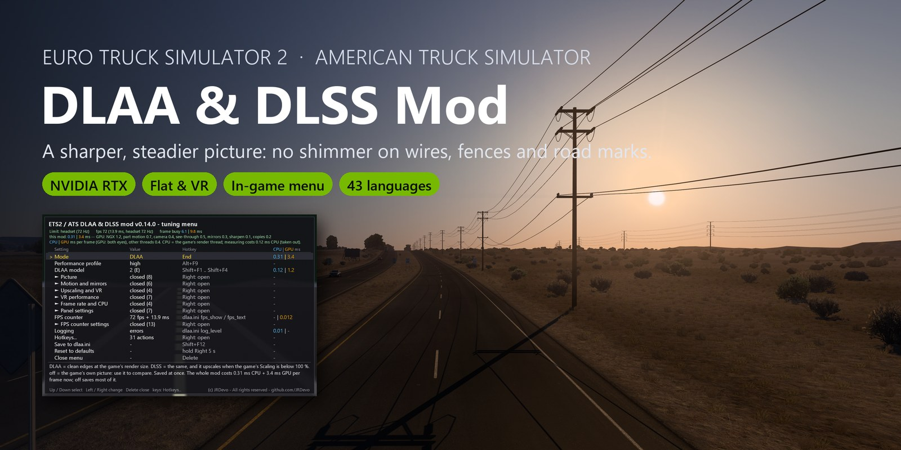

<!-- Short README in French (Canada, Québec). The full guide (English): ../../README.md -->
> [!CAUTION]
> **Téléchargez ce mod uniquement sur https://github.com/JRDevo/ETS2-ATS-DLAA-DLSS-Injection-Mod/releases.** Il n'y a ni site web, ni Discord,
> ni Nexus, ni Steam Workshop. Tout autre site, miroir ou « installateur » qui le propose n'est pas de moi : ne l'exécutez pas.

# ETS2 & ATS: DLAA & DLSS Injection Mod

**DLAA** et **DLSS** de NVIDIA pour **Euro Truck Simulator 2** et **American Truck Simulator**, sur écran plat et en VR.
Le mod remplace l'anticrénelage du jeu par le DLAA : grillages, fils, marquages routiers et ombres ne scintillent plus.
Le DLSS peut aussi agrandir l'image pour plus d'images par seconde.

C'est un seul petit fichier, `dinput8.dll`, dans le dossier du jeu. Pas de lanceur, pas de compte.

- **Une image stable et nette :** pas de scintillement sur les grillages, les fils et les ombres. Les rétroviseurs sont lissés aussi.
- **Écran plat et VR :** un seul fichier pour les deux. Les triples écrans et le HDR de Windows fonctionnent.
- **Accélérations VR :** rendu fovéal (aussi avec suivi oculaire), DLAA seulement au milieu de chaque œil, limites de fréquence d'images.
- **Un menu dans le jeu, dans votre langue :** appuyez sur `Delete`. Chaque réglage, sa touche et son coût, avec une courte description.
- **Un rapport de bogue en une pression :** appuyez deux fois sur `Insert`. Le mod enregistre images, infos système et journaux dans des zips.

## Ce qu'il vous faut

- Euro Truck Simulator 2 ou American Truck Simulator (64 bits, DirectX 11).
- Une carte graphique **NVIDIA RTX** avec un pilote récent. Le DLAA et le DLSS ne tournent que sur les cartes RTX.
- Le fichier `nvngx_dlss.dll` (l'environnement d'exécution NVIDIA DLSS). Le mod ne l'inclut pas : voir l'étape 6.
- Pour la VR : un runtime OpenXR (par exemple Virtual Desktop), et le jeu lancé avec l'option `-openxr`.

## Installation

1. **Faites une copie de sauvegarde** du dossier `bin\win_x64\` du jeu.
2. [Téléchargez la dernière version](https://github.com/JRDevo/ETS2-ATS-DLAA-DLSS-Injection-Mod/releases/latest) : le `.zip` sous **Assets**. Décompressez-le.
3. Ouvrez le dossier du jeu, par exemple `...\steamapps\common\Euro Truck Simulator 2\bin\win_x64\`
   (ou `...\American Truck Simulator\bin\win_x64\`).
4. **Retirez d'abord les autres mods proxy :** supprimez tout autre `dinput8.dll` ou `dxgi.dll` de ce dossier.
5. Copiez **`dinput8.dll`** dans `bin\win_x64\`. Vous pouvez aussi y copier **`dlaa.ini`** pour changer les réglages et les touches (facultatif).
6. Mettez **`nvngx_dlss.dll`** dans le même dossier. Prenez-le dans le SDK NVIDIA DLSS (<https://github.com/NVIDIA/DLSS>,
   fichier `lib/Windows_x86_64/rel/nvngx_dlss.dll`) ou copiez-le depuis un jeu qui l'a.
7. Lancez le jeu. Le DLAA est activé.

Pour désinstaller : supprimez `dinput8.dll` (et `dlaa.ini`) de `bin\win_x64\`.

**Linux / Proton :** installez de la même façon. Dans Steam, mettez ceci dans les options de lancement du jeu : `WINEDLLOVERRIDES="dinput8=n,b" %command%`.

## Les touches les plus importantes

| Touche | Ce qu'elle fait |
|---|---|
| `Delete` | Ouvre et ferme le menu. `Up` / `Down` choisissent une ligne, `Left` / `Right` la changent. |
| `End` | Change le mode : désactivé, DLAA, DLSS. |
| `Insert` deux fois | Rapport de bogue : enregistre images, infos système et journaux dans `dlaa_selftest\`. |

## Pour en savoir plus

- **Le guide complet (anglais) :** [README.md](../../README.md) : tous les réglages, touches, VR, performances et dépannage.
- **Un problème ?** [Ouvrez une issue](https://github.com/JRDevo/ETS2-ATS-DLAA-DLSS-Injection-Mod/issues/new/choose). Merci de l'écrire en anglais.
- **Les traductions** sont faites par IA et peuvent contenir des erreurs.
  [Signaler un problème de traduction](https://github.com/JRDevo/ETS2-ATS-DLAA-DLSS-Injection-Mod/issues/new?template=translation.yml).
- Ceci est un projet de fan non officiel. Il n'est pas affilié à SCS Software ni à NVIDIA.
